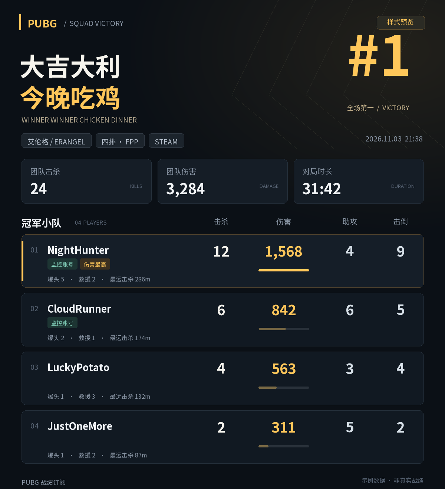

# PUBG 吃鸡战报 · AstrBot 插件

**PUBG Chicken Dinner Reports — an AstrBot plugin for Steam PUBG and QQ groups.**

## For PUBG API application reviewers

This plugin lets QQ gaming communities subscribe to selected Steam PUBG players by their in-game nicknames. When a subscribed player wins a completed match, it generates a squad report image and sends it to the subscribed group through AstrBot's OneBot v11 adapter.

Reports include all winning teammates and their kills, damage, assists, knockdowns, headshots, revives, and longest kills, together with map, perspective, match time, duration, and team totals. The screenshot below is explicitly labeled **sample data**, rather than a claim about a real match.

The implementation uses the official PUBG API to resolve stable account IDs, batch recent-match lookups for up to 10 players, and fetch newly discovered match details. SQLite stores subscriptions, processed match IDs, and pending reports. Multiple subscribed teammates are merged into one notification per match and group. Failed requests and deliveries are retried with backoff.

The plugin has been installed in an AstrBot deployment and its image rendering has been verified there. The repository includes 36 offline tests using local HTTP fixtures and simulated AstrBot interfaces; these are not a substitute for live PUBG API and QQ integration testing. An API key is required for live monitoring.

The initial audience is Chinese-speaking PUBG communities. This is currently a non-commercial personal project with no advertising, subscriptions, or data sales. The next development phase is controlled multi-account testing; no production traffic volume is claimed.

### Quick start

1. Install this directory under AstrBot's `data/plugins/astrbot_plugin_pubg_chicken/`, or install the packaged ZIP through AstrBot's plugin manager.
2. Configure a PUBG API key from [the official developer portal](https://developer.pubg.com/) and reload the plugin.
3. In a QQ group connected through OneBot v11, run `/pubg test` to generate a sample report.
4. Run `/pubg add YourInGameName` to subscribe. Existing match history is used as a baseline and skipped.

The plugin includes Noto Sans SC under its original SIL Open Font License. API keys belong in AstrBot's local plugin configuration, not in this repository.

---

监控 Steam 版 PUBG 的游戏内昵称，发现吃鸡后，向订阅群发送黑金风格的冠军小队图片。包括全部队友，未订阅的队友也会展示。



图片包含地图、视角、对局时间、团队击杀、团队伤害、对局时长，以及每人的击杀、伤害、助攻、击倒、爆头、救援和最远击杀。监控账号和伤害最高者会单独标记。队员按伤害降序排列；这里的“伤害最高”只是队内伤害比较，不是官方 MVP 评级。

## 安装

环境：AstrBot 4.9.2 或以上的 4.x 版本、Python 3.10+，QQ 使用 **OneBot v11 / aiocqhttp** 适配器，例如 NapCat。机器人需要已在目标群内，能够正常发图片。

1. 在 AstrBot 插件管理中从本地安装 `astrbot_plugin_pubg_chicken-v1.0.0.zip`。
2. 打开插件配置，填写 `api_key`，保存并重载插件。
3. 在目标 QQ 群发送 `/pubg 测试`，应收到一张标有“示例数据”的战报。
4. 在同一群发送 `/pubg 添加 你的游戏内昵称`，开始监控。

如果所用 AstrBot 版本没有 ZIP 安装入口，将 ZIP 中的 `astrbot_plugin_pubg_chicken` 文件夹解压到 AstrBot 的 `data/plugins/`，确保路径为 `data/plugins/astrbot_plugin_pubg_chicken/main.py`，然后重启或重载插件。依赖在 `requirements.txt`；若自动安装依赖失败，请在 AstrBot 使用的 Python 环境执行：

```bash
python -m pip install -r data/plugins/astrbot_plugin_pubg_chicken/requirements.txt
```

插件已附带 Noto Sans SC 中文字体及其 OFL 许可证，Linux/Docker 不必额外安装字体。也可在 `font_path` 中指定 AstrBot 容器内可读的中文字体文件。

### 获取 PUBG API Key

在 [PUBG Developer Portal](https://developer.pubg.com/) 登录并创建应用，将获得的 API Key 填入 AstrBot 的本插件配置。只在配置界面填写，不要发送到 QQ 群。应用 Key 默认有请求限额；本插件按每批最多 10 人查询，所有玩家请求间隔至少 6.5 秒。

## 群内命令

`/` 应替换为你的 AstrBot 指令唤醒前缀。也可使用中文主命令 `吃鸡战报` 代替 `pubg`。

| 命令 | 用途 | 权限 |
| --- | --- | --- |
| `/pubg` | 查看帮助 | 群成员 |
| `/pubg 添加 NightHunter` | 监控一个 PUBG 游戏内昵称 | AstrBot 管理员或本群群主、管理员 |
| `/pubg 删除 NightHunter` | 移除本群订阅 | 同上 |
| `/pubg 列表` | 查看本群订阅 | 群成员 |
| `/pubg 状态` | 查看配置状态、轮询时间、待发数量和异常 | 群成员 |
| `/pubg 测试` | 发送示例图片，不查询真实战绩 | 管理员 |

英文子命令也可用：`add`、`del`、`list`、`status`、`test`、`help`。

填写的是 **PUBG 游戏内昵称**，不是 Steam 昵称、Steam ID 或登录账号。首次添加需先成功查询玩家，并将已有对局保存为基线。随后出现的新战绩才会判断是否吃鸡。同一个人可以被不同群订阅；数据查询会按账号合并，但每个群独立接收通知。

昵称修改后仍按官方 account ID 持续监控，并自动更新列表中的昵称。删除时可用当前昵称、初次订阅时的昵称或 account ID。

## 配置

| 配置 | 默认值 | 说明 |
| --- | --- | --- |
| `api_key` | 空 | PUBG API Key，必须填写才能查询战绩 |
| `enabled` | `true` | 是否进行自动查询和发送；关闭后保留订阅 |
| `poll_seconds` | `60` | 每轮结束后的等待秒数，最少 30 秒 |
| `allowed_group_ids` | `[]` | 允许的 QQ 群号字符串列表，空为所有群 |
| `allow_group_admin` | `true` | 允许本群群主/管理员管理订阅；关闭后仅 AstrBot 管理员可管理 |
| `max_players_per_group` | `50` | 每群订阅人数上限 |
| `max_age_hours` | `6` | 忽略过旧对局，发送失败的战报在该时限内重试，范围 1–72 |
| `include_custom_matches` | `false` | 是否包含标准模式的自定义房间 |
| `proxy` | 空 | PUBG 查询使用的 HTTP 代理；留空按环境变量或直连 |
| `font_path` | 空 | 自定义中文字体文件路径，留空使用自带字体 |

修改配置后重载插件。通常只需填写 API Key；允许群列表建议用于限定具体服务群。

## 发送与去重

- 每个群、每场对局只建立一条待发战报。同队多名订阅玩家会合并到一张图，并标记这些玩家。
- 使用对局的 roster 队伍关系找到冠军全部队友，不要求队友都添加监控。
- 战报生成和图片发送均使用本地数据；不依赖 LLM 或第三方截图服务。
- 图片通过 Base64 消息发送，适用于 AstrBot 与 NapCat 在不同容器中的部署。
- 对局处理结果与待发记录在 SQLite 事务中一起保存；正常重启不会重复发送已经确认完成的战报。
- 网络故障、数据暂未完整、绘图失败、机器人断连时会重试。发送重试间隔从 30 秒逐步增长至最多 30 分钟。
- 若 QQ 已收到图片，但发送端未收到确认或在落库前断电，重试仍可能重复；消息系统无法保证这类情况下绝对只送达一次。
- 删除订阅会取消不再有相关吃鸡订阅玩家的待发战报。切换平台适配器 ID 后，需要在新平台连接上重新添加订阅。

持久化目录为 AstrBot 的 `data/plugin_data/astrbot_plugin_pubg_chicken/`。订阅、已处理对局及待发队列保存在 `monitor.sqlite3`，插件更新不会覆盖此目录。Docker 部署应持久化 AstrBot 的 `data` 目录。

## 数据范围与延迟

仅监控 Steam 端的标准单排、双排、四排，支持 TPP/FPP 和 `normal-*` 模式。默认跳过自定义房间；团队竞技、训练、实验玩法等不会播报。PUBG Mobile 不在本插件范围内。

PUBG 官方战绩存在更新延迟，通知时间取决于官方数据入库与轮询时机，无法保证结算后立刻发送。图片显示官方 `createdAt` 转换为北京时间后的对局时间和官方 `duration`；不把轮询时间当成比赛时间。接口可用的历史对局有限，长时间停机无法保证补齐所有战绩。

## 验证范围

开发时完成了本地 HTTP 接口模拟、SQLite 持久化测试、AstrBot 事件/发送接口模拟和真实 PNG 渲染检查。测试不会访问真实 PUBG 账号，也不会给 QQ 群发消息。真实 API Key、实际 AstrBot 安装版本和 QQ 群连通性仍需安装后验证。

源码测试（在插件目录的上一级执行）：

```bash
python -m unittest discover -s astrbot_plugin_pubg_chicken/tests -t . -v
```

## 参考与字体许可

- [AstrBot 插件开发](https://docs.astrbot.app/dev/star/plugin-new.html)
- [AstrBot 主动消息](https://docs.astrbot.app/dev/star/guides/send-message.html)
- [PUBG API](https://documentation.pubg.com/en/getting-started.html)
- [PUBG FAQ 与延迟说明](https://developer.pubg.com/faq?locale=en)
- 字体来源：[Google Fonts / Noto Sans SC](https://github.com/google/fonts/tree/main/ofl/notosanssc)，许可证见 `assets/OFL.txt`。字体原样分发，独立遵循 SIL Open Font License 1.1。

本插件是非官方工具，与 PUBG/KRAFTON 无隶属关系。
